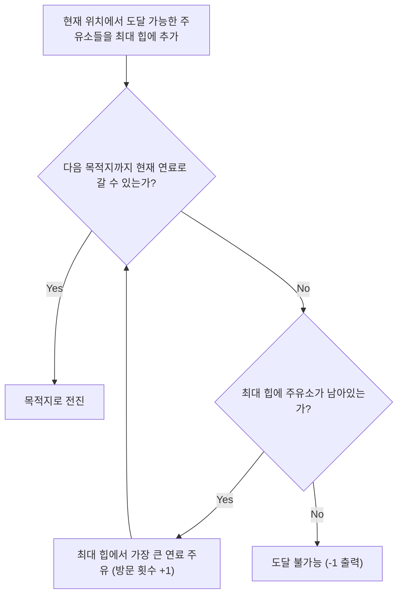

## 1. 문제 개요 및 조건 분석

| 항목 | 내용 |
| :--- | :--- |
| **문제 이름** | 연료 채우기 (백준 1826번 / 골드 2) |
| **플랫폼 / 난이도** | 백준 (골드 2, 1826번) |
| **문제 링크** | [백준 1826번](https://www.acmicpc.net/problem/1826) |
| **제한 사항** | 시간 제한 2초, 메모리 제한 128MB |
| **입력 조건** | 주유소 개수 $N$ ($1 \le N \le 10,000$), 마을 거리 $L \le 1,000,000$, 초기 연료 $P \le 1,000,000$ |
| **핵심 목표** | 마을에 도착하기 위해 주유소를 들르는 최소 횟수 계산 (도착 불가능 시 -1) |

---

## 2. 접근 아이디어: 탐욕법(Greedy) & 최대 힙(PriorityQueue)

### 직관적인 그리디 접근
- 자동차가 연료 1당 1km를 이동합니다.
- 현재 보유한 연료로 갈 수 있는 모든 주유소를 지나치면서, **"주유소의 연료량을 일단 우선순위 큐(최대 힙)에 담아둔다"**고 생각합니다.
- 만약 가다가 다음 주유소(또는 마을)에 도달할 수 없을 만큼 연료가 부족해지면, **지금까지 지나쳐온 주유소 중 가장 연료를 많이 주는 곳을 골라 주유**합니다.
- 이렇게 하면 주유 횟수를 최소화하면서 항상 가장 많은 연료를 공급받는 최적해가 보장됩니다.



---

## 3. Java 풀이 코드

```java
import java.io.*;
import java.util.*;

public class Main {
    static class Station implements Comparable<Station> {
        int dist, fuel;
        Station(int dist, int fuel) {
            this.dist = dist;
            this.fuel = fuel;
        }
        @Override
        public int compareTo(Station o) {
            return this.dist - o.dist; // 거리 오름차순 정렬
        }
    }

    public static void main(String[] args) throws IOException {
        BufferedReader br = new BufferedReader(new InputStreamReader(System.in));
        int n = Integer.parseInt(br.readLine());

        Station[] stations = new Station[n];
        for (int i = 0; i < n; i++) {
            StringTokenizer st = new StringTokenizer(br.readLine());
            stations[i] = new Station(Integer.parseInt(st.nextToken()), Integer.parseInt(st.nextToken()));
        }

        StringTokenizer st = new StringTokenizer(br.readLine());
        int targetDist = Integer.parseInt(st.nextToken());
        int curFuel = Integer.parseInt(st.nextToken());

        // 주유소를 거리순 정렬
        Arrays.sort(stations);

        // 지나친 주유소 중 가장 많은 연료를 주는 주유소를 꺼낼 최대 힙
        PriorityQueue<Integer> pq = new PriorityQueue<>(Collections.reverseOrder());

        int stopCount = 0;
        int idx = 0;

        while (curFuel < targetDist) {
            // 현재 보유한 연료로 갈 수 있는 모든 주유소를 큐에 삽입
            while (idx < n && stations[idx].dist <= curFuel) {
                pq.add(stations[idx].fuel);
                idx++;
            }

            // 더 이상 갈 수 없는데 주유할 곳도 없으면 도달 불가
            if (pq.isEmpty()) {
                System.out.println(-1);
                return;
            }

            // 가장 연료를 많이 채워주는 주유소 선택
            curFuel += pq.poll();
            stopCount++;
        }

        System.out.println(stopCount);
    }
}
```

---

## 4. 복잡도 분석

- **시간 복잡도**: $O(N \log N)$ — 주유소 정렬 $O(N \log N)$ + 각 주유소는 최대 힙에 1회 삽입 및 1회 삭제되므로 $O(N \log N)$. $N = 10,000$이므로 수 밀리초 내에 즉시 통과.
- **공간 복잡도**: $O(N)$ — 주유소 배열 및 우선순위 큐 메모리.

---

## 5. 채점 결과 및 통과 인증


