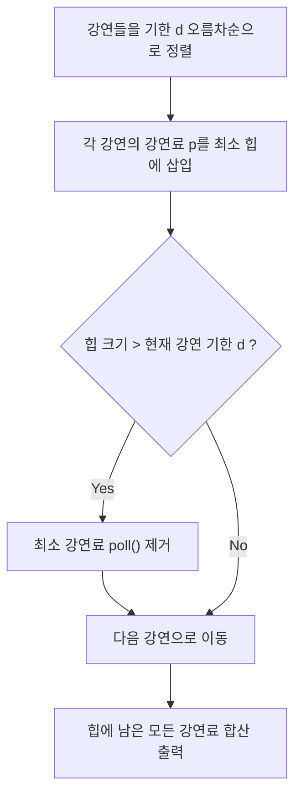

## 1. 문제 개요 및 조건 분석

| 항목 | 내용 |
| :--- | :--- |
| **문제 이름** | 순회강연 (백준 2109번 / 골드 3) |
| **플랫폼 / 난이도** | 백준 (골드 3, 2109번) |
| **문제 링크** | [백준 2109번](https://www.acmicpc.net/problem/2109) |
| **제한 사항** | 시간 제한 2초, 메모리 제한 128MB |
| **입력 조건** | 강연 요청 대학 수 $n$ ($0 \le n \le 10,000$), 강연료 $p \le 10,000$, 마감 기한 $d \le 10,000$ |
| **핵심 규칙** | 하루에 최대 한 곳에서만 강연할 수 있을 때, 얻을 수 있는 최대 강연료 수익 구하기 |

---

## 2. 접근 아이디어: 그리디 & 최소 힙 (PriorityQueue)

### 기한 기준 정렬 및 최소 힙 운용
1. **기한 오름차순 정렬**:
   - 강연들을 마감 기한($d$)이 빠른 순서로 정렬합니다. (기한이 같다면 강연료 기준 정렬)
2. **최소 힙(PriorityQueue)으로 최적 강연 유지**:
   - 정렬된 강연을 하나씩 확인하며 강연료를 최소 힙에 삽입합니다.
   - 힙에 들어있는 원소의 개수는 **"현재까지 선택하여 진행하기로 한 강연의 수"**이자 **"필요한 총 일수"**입니다.
   - 만약 힙의 크기가 현재 강연의 마감일($d$)을 초과하게 되면, 지금까지 선택한 강연 중 **가장 강연료가 낮은 강연(`pq.poll()`)을 버립니다**.
3. **최종 합산**:
   - 모든 강연을 확인한 후 힙에 남아있는 모든 강연료를 합산하면 가능한 최대 수익이 됩니다.



---

## 3. Java 풀이 코드

```java
import java.io.*;
import java.util.*;

public class Main {
    static class Lecture implements Comparable<Lecture> {
        int pay, day;

        Lecture(int pay, int day) {
            this.pay = pay;
            this.day = day;
        }

        @Override
        public int compareTo(Lecture o) {
            if (this.day == o.day) {
                return o.pay - this.pay;
            }
            return this.day - o.day; // 기한 오름차순 정렬
        }
    }

    public static void main(String[] args) throws IOException {
        BufferedReader br = new BufferedReader(new InputStreamReader(System.in));
        int n = Integer.parseInt(br.readLine());

        Lecture[] lectures = new Lecture[n];
        for (int i = 0; i < n; i++) {
            StringTokenizer st = new StringTokenizer(br.readLine());
            lectures[i] = new Lecture(Integer.parseInt(st.nextToken()), Integer.parseInt(st.nextToken()));
        }

        Arrays.sort(lectures);

        // 강연료를 담을 최소 힙
        PriorityQueue<Integer> pq = new PriorityQueue<>();

        for (Lecture lec : lectures) {
            pq.add(lec.pay);
            // 선택된 강연 수가 기한을 넘어가면 가장 싼 강연을 포기
            if (pq.size() > lec.day) {
                pq.poll();
            }
        }

        int total = 0;
        while (!pq.isEmpty()) {
            total += pq.poll();
        }

        System.out.println(total);
    }
}
```

---

## 4. 복잡도 분석

- **시간 복잡도**: $O(N \log N)$ — 정렬 $O(N \log N)$ + 각 원소당 힙 삽입/삭제 $O(\log N)$. $N = 10,000$이므로 0.2초 이내 여유 있게 완료.
- **공간 복잡도**: $O(N)$ — 배열 및 우선순위 큐 메모리.

---

## 5. 채점 결과 및 통과 인증


