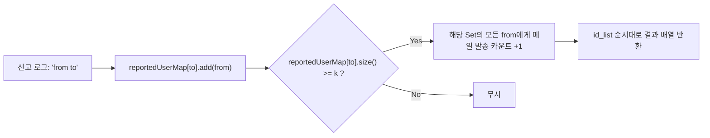

## 1. 문제 개요 및 조건 분석

| 항목 | 내용 |
| :--- | :--- |
| **문제 이름** | 신고 결과 받기 (Level 1) |
| **플랫폼 / 난이도** | 프로그래머스 (Level 1) / 2022 KAKAO BLIND RECRUITMENT |
| **문제 링크** | [프로그래머스 신고 결과 받기 (Level 1)](https://school.programmers.co.kr/learn/courses/30/lessons/92334) |
| **입력 조건** | 유저 수 $N$ ($2 \le N \le 1,000$), 신고 건수 $M$ ($1 \le M \le 200,000$), 정지 기준 $k$ ($1 \le k \le 200$) |
| **핵심 규칙** | 동일인이 같은 사람을 여러 번 신고해도 1회로 간주, $k$회 이상 신고당한 유저는 정지되며 신고자들에게 처리 결과 메일 1통씩 발송 |

---

## 2. 접근 아이디어 및 자료구조 설계

### 핵심 설계
1. **중복 신고 제거**:
   - 동일 유저의 중복 신고를 걸러내기 위해 `신고당한 사람`을 Key로, `신고한 사람들의 Set`(`HashSet<String>`)을 Value로 관리합니다.
2. **순서 보장 결과 매핑**:
   - 최종 결과는 입력으로 주어진 `id_list`의 순서대로 메일 발송 횟수를 출력해야 합니다.
   - 각 유저별 발송 카운트를 저장하기 위해 초기 순서를 보장하거나 별도 배열 인덱스 맵을 활용합니다.



---

## 3. Java 풀이 코드

```java
import java.io.*;
import java.util.*;

class Solution {
    public int[] solution(String[] id_list, String[] report, int k) {
        Board board = new Board(id_list, k);
        board.update(report);
        return board.getResponse();
    }

    static class Board {
        private final int criteria;
        // Key: 피신고자, Value: 해당 유저를 신고한 유저들의 Set (중복 자동 제거)
        private final Map<String, Set<String>> reportedMap = new HashMap<>();
        // Key: 신고자, Value: 메일 수신 횟수 (id_list의 순서 유지를 위해 LinkedHashMap 사용)
        private final Map<String, Integer> mailCountMap = new LinkedHashMap<>();

        public Board(String[] idList, int criteria) {
            this.criteria = criteria;
            for (String id : idList) {
                reportedMap.put(id, new HashSet<>());
                mailCountMap.put(id, 0);
            }
        }

        public void update(String[] report) {
            // 1. 신고 로그 파싱 및 Set 등록
            for (String s : report) {
                String[] log = s.split(" ");
                String reporter = log[0];
                String reported = log[1];
                reportedMap.get(reported).add(reporter);
            }

            // 2. 기준 횟수(k) 이상 신고된 유저를 찾고, 신고자들에게 메일 카운트 증가
            for (Set<String> reporters : reportedMap.values()) {
                if (reporters.size() >= criteria) {
                    for (String reporter : reporters) {
                        mailCountMap.put(reporter, mailCountMap.get(reporter) + 1);
                    }
                }
            }
        }

        public int[] getResponse() {
            return mailCountMap.values().stream()
                    .mapToInt(Integer::intValue)
                    .toArray();
        }
    }
}
```

---

## 4. 복잡도 분석

- **시간 복잡도**:
  - 유저 초기화: $O(N)$
  - 신고 처리: $M$개의 문자열 파싱 및 해시셋 삽입 $O(M)$
  - 메일 집계: 최대 $N$명의 유저 및 고유 신고자 순회 $O(N + M)$
  - 전체 $O(N + M)$으로 약 $20만$ 연산 이내, $0.1초$ 미만에 가볍게 통과.
- **공간 복잡도**: $O(N + M)$ — 유저 맵과 중복 제거된 신고자 Set 저장 공간.

---

## 5. 채점 결과 및 통과 인증


